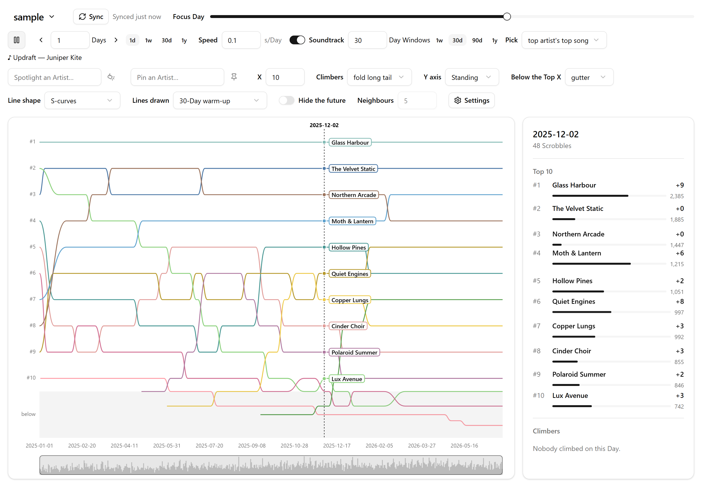
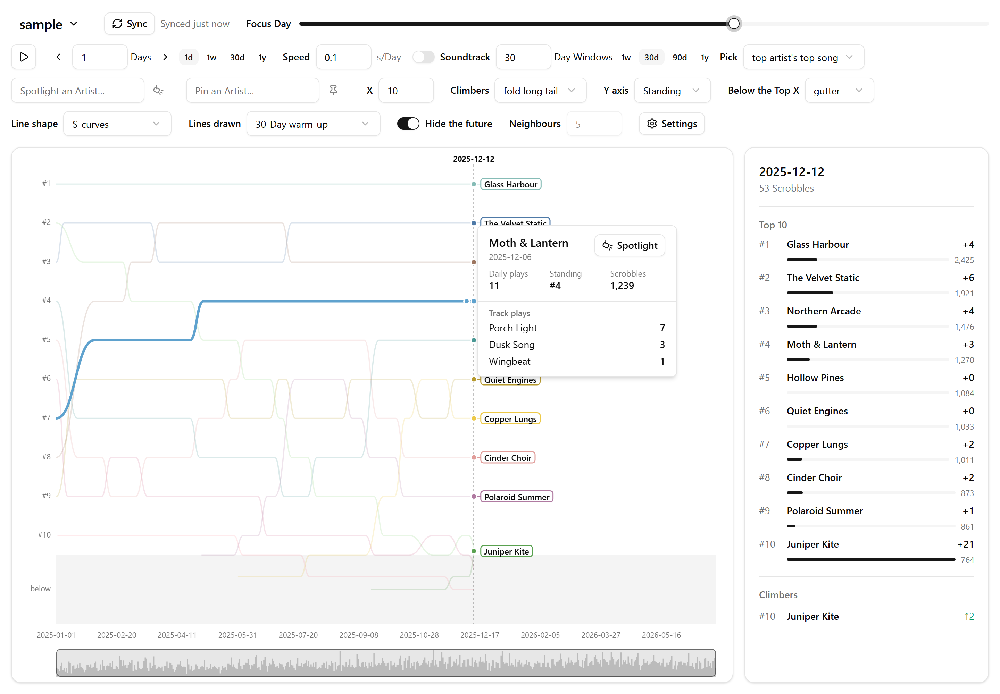
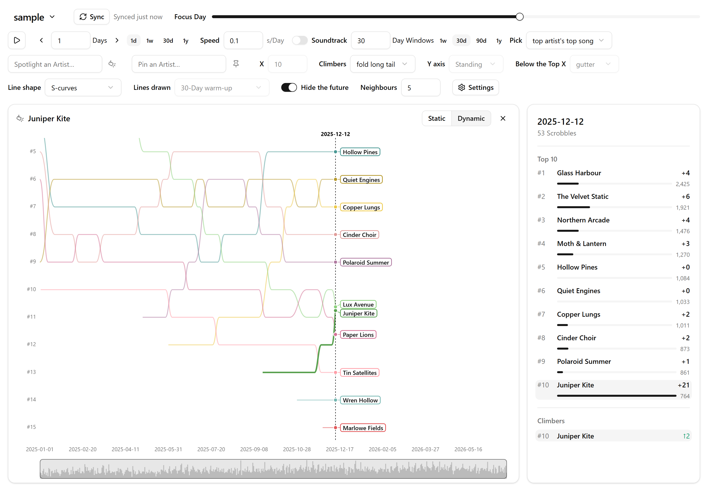

# Chronoscribe

Personal data visualizations of last.fm listening histories. Chronoscribe imports a Listener's whole Scrobble history into the browser and plays it back as a timeline: every Artist's Standing, Day by Day, from the first Scrobble to today.

It runs entirely in the browser. There is no server: Scrobbles are stored in IndexedDB, and nothing leaves the tab except requests to last.fm (and to Spotify, if you connect it).



## Features

- **Import and Sync**: fetch a Listener's whole history from last.fm, pausing and resuming as needed, then Sync recent Scrobbles to pick up late and deleted ones.
- **Standings timeline**: a zoomable, pannable chart of the Top X Artists' Standings over time, with a Daily volume minimap and a player that steps or glides through the Days.
- **Focus Day**: the Top X, Daily plays and Climbers for the Day the timeline is inspecting; hover a line to see that Day's Track plays.
- **Pinned Artists**: keep chosen Artists on the chart whether or not they are in the Top X.
- **Spotlight**: follow one Artist's Standing over time alongside their Neighbours.
- **Soundtracks**: the song that sums up each Window of Days, playable in the tab through Spotify.
- **Multiple Listeners**: keep several histories side by side and view them one at a time.

[`GLOSSARY.md`](GLOSSARY.md) defines each of these terms precisely.

| Hover a line for that Day's Track plays                                | Spotlight an Artist among their Neighbours                     |
| ---------------------------------------------------------------------- | -------------------------------------------------------------- |
|  |  |

The screenshots show a made-up Listener. `pnpm screenshots` imports that history into the app and takes them again.

## Getting started

You need Node 24 and pnpm (the version is pinned in `package.json`, so `corepack enable` will fetch it).

```bash
pnpm install
```

```bash
pnpm dev
```

Then open <http://127.0.0.1:5273>. Use `127.0.0.1`, not `localhost`: Spotify only redirects back to the loopback IP.

To add a Listener you need their last.fm username and a [last.fm API key](https://www.last.fm/api/account/create). The key is stored in the browser alongside the history.

### Spotify (optional)

Playing Soundtracks needs a Spotify app's Client ID, built in at build time. Without one, the app simply shows no Spotify controls.

1. Create an app in the [Spotify developer dashboard](https://developer.spotify.com/dashboard), with `http://127.0.0.1:5273/` as a redirect URI and the Web API and Web Playback SDK enabled.
2. Put its Client ID in `.env.local`:

    ```
    VITE_SPOTIFY_CLIENT_ID=your-client-id
    ```

Playback needs a Spotify Premium account and a browser with DRM support. In Development Mode, Spotify allows at most 5 allowlisted accounts per app. [ADR 0003](docs/adr/0003-spotify-through-web-playback-sdk.md) explains why it works this way.

## Scripts

| Command            | What it does                                                   |
| ------------------ | -------------------------------------------------------------- |
| `pnpm dev`         | Start the dev server on `http://127.0.0.1:5273`                |
| `pnpm build`       | Type-check and build the static site into `dist/`              |
| `pnpm preview`     | Serve the production build                                     |
| `pnpm test`        | Run the unit and service tests (Vitest)                        |
| `pnpm e2e`         | Run the end-to-end tests (Playwright) against faked APIs       |
| `pnpm check`       | Type-check, lint, check formatting, test and build, as CI does |
| `pnpm screenshots` | Retake the README's screenshots in `docs/screenshots/`         |
| `pnpm fmt`         | Format the code (oxfmt)                                        |

Before the first `pnpm e2e`, install the browser with `pnpm exec playwright install chromium`. The tests never call the real last.fm or Spotify.

## Stack

Vite, React 19 and strict TypeScript; Dexie over IndexedDB; Zustand for state; Zod at every boundary; a Web Worker over Comlink to build the Standings; Canvas 2D and D3 for the chart; Tailwind and shadcn/ui for the interface; Vitest and Playwright for tests; oxlint and oxfmt for linting and formatting.

## Contributing

- [`docs/agents/coding-standards.md`](docs/agents/coding-standards.md) covers module layering, the functional and event-driven architecture, state, errors, UI and testing. Every change follows it.
- [`GLOSSARY.md`](GLOSSARY.md) is the domain language, used as written in code, tests and UI copy.
- [`docs/adr/`](docs/adr/) records decisions that are hard to reverse.
- Commits use [Conventional Commits](https://www.conventionalcommits.org/) (`type(scope): subject`). `pnpm install` sets up git hooks that enforce this and run `pnpm check` before each commit.
- Issues are tracked in [GitHub Issues](https://github.com/ernestasgr/chronoscribe/issues).
